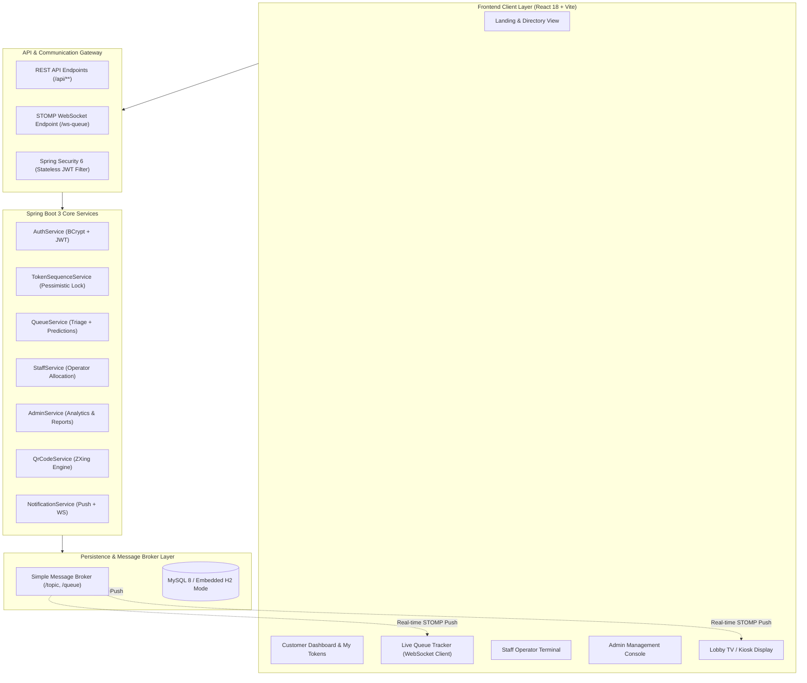
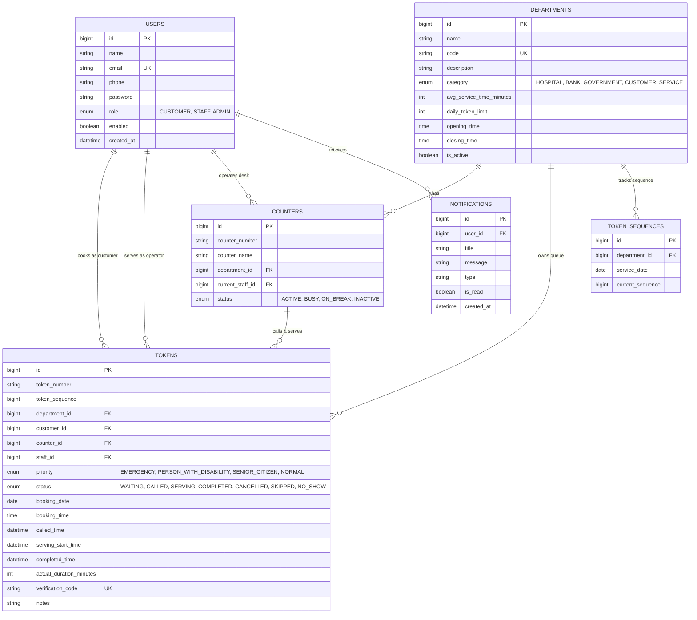
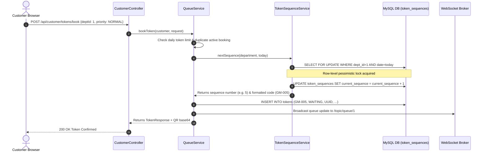

# Q-Flow: Smart Queue Management System Architecture

## 1. System Overview

**Q-Flow** is an enterprise-grade, responsive full-stack platform designed to eliminate physical waiting lines in high-traffic service institutions. It features a reactive, event-driven architecture using **Spring Boot 3 (Java 17)**, **React 18 with Vite**, **Tailwind CSS**, and **STOMP WebSockets** over SockJS with a database-backed transaction-safe sequence generator.

---

## 2. High-Level Architecture Diagram

---

## 3. Entity-Relationship (ER) Data Model

---

## 4. Concurrency-Safe Sequence & Token Generation

To satisfy strict anti-collision requirements, the sequence mechanism guarantees:
1. No `MAX(token_number) + 1` race conditions.
2. A separate `token_sequences` table with composite unique constraint `(department_id, service_date)`.
3. Java `@Lock(LockModeType.PESSIMISTIC_WRITE)` executing inside `@Transactional(propagation = Propagation.REQUIRES_NEW)`.
4. Immediate commit of sequence counter so concurrent customer transactions serialize cleanly.

---

## 5. Smart Waiting-Time Prediction Algorithm

Estimated waiting time is computed dynamically using:
- **$P$**: Number of customers ahead in queue for the same department and date with higher priority or earlier timestamp.
- **$C$**: Total active and busy counters currently serving that department:
  $$\text{Effective Counters } C_{\text{eff}} = \max(1, C_{\text{active}} + C_{\text{busy}})$$
- **$D_{\text{avg}}$**: Blended rolling average service duration:
  $$D_{\text{eff}} = \begin{cases} 
  0.7 \times \bar{D}_{\text{completed today}} + 0.3 \times D_{\text{configured default}}, & \text{if completed visits } \ge 1 \\
  D_{\text{configured default}}, & \text{otherwise}
  \end{cases}$$
- **Formula**:
  $$\text{Estimated Waiting Time (minutes)} = \max\left(2, \; \left\lceil \frac{P}{C_{\text{eff}}} \times D_{\text{eff}} \right\rceil\right)$$

This accounts for parallel desks serving in the same pool, and adapts dynamically as operators work faster or handle more complex cases throughout the day.

---

## 6. Priority Queue Triage

Customers are queued with an explicit multi-tiered rank:

| Priority Category | Rank | Use Cases | Precedence |
|---|:---:|---|---|
| **EMERGENCY** | 1 | Acute medical trauma, severe clinical distress | Called first by next open counter |
| **PERSON_WITH_DISABILITY** | 2 | Wheelchair users, visual/hearing impaired | Served ahead of general queue |
| **SENIOR_CITIZEN** | 3 | Elderly citizens (60+ years of age) | High-priority civic and banking service |
| **NORMAL** | 4 | Standard walk-in or booked appointment | Standard FIFO processing |
